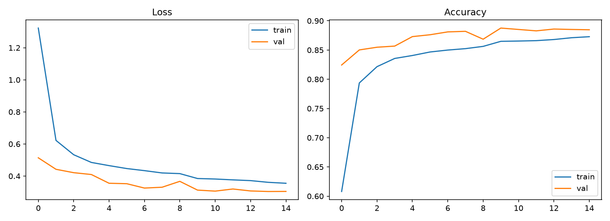
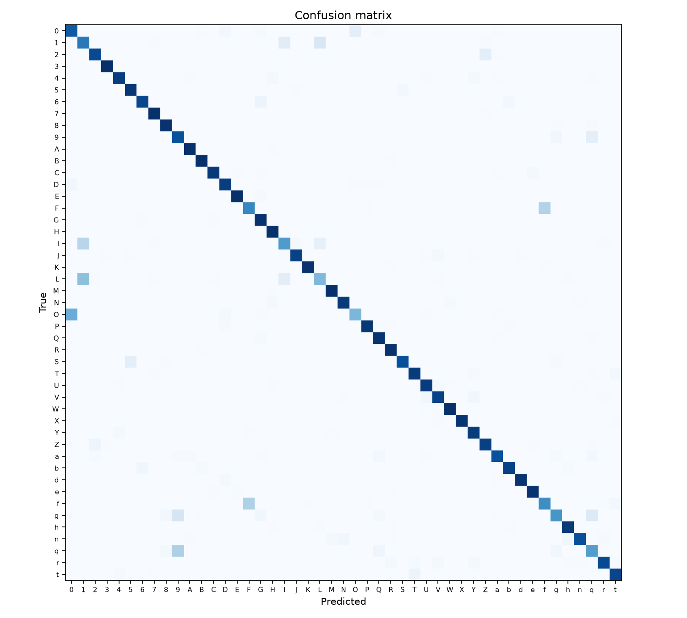

# CodeAlpha_HandwrittenCharacterRecognition

My submission for **Task 3: Handwritten Character Recognition** in the CodeAlpha Machine Learning Internship.

In this project I built a Convolutional Neural Network (CNN) that recognises handwritten digits (MNIST) and handwritten digits plus letters (EMNIST Balanced), and a small script that predicts the character in my own handwriting photos.

---

## What I did, step by step

### Step 1: Read the task
The task asked me to identify handwritten characters using image processing and deep learning, with MNIST or EMNIST as the dataset and a CNN as the model. I chose to do both datasets: MNIST first as a quick baseline, then EMNIST to include letters.

### Step 2: Set up my environment
- I created a project folder, `CodeAlpha_HandwrittenCharacterRecognition`, as the internship instructions require.
- I installed the libraries from `requirements.txt` with `pip install -r requirements.txt` (TensorFlow, Keras, TensorFlow Datasets, scikit-learn, NumPy, Matplotlib, Pillow).
- My setup: Windows, Python 3.14, TensorFlow 2.22 (release candidate).

### Step 3: Fix the setup problems I ran into
- I first tried to install TensorFlow with `npm` by mistake. TensorFlow is a Python library, so the correct tool is `pip`.
- I ran `predict.py` before training, so it could not find the model file. The fix was to train first, then predict.
- I forgot the space before `--dataset` in the training command, which made Python say the file didn't exist. The correct form is `python handwritten_recognition.py --dataset mnist`.
- VS Code underlined `tensorflow.keras` imports. This was only an editor warning, so I switched the code to `import keras` and `from keras import layers, models, callbacks`.

### Step 4: Load and prepare the data
In `handwritten_recognition.py` I:
1. Load MNIST from Keras, or EMNIST Balanced from `tensorflow_datasets`.
2. Fix the EMNIST images, which are stored transposed, so letters face the right way.
3. Scale pixel values from 0-255 to 0-1 and reshape each image to 28x28x1.

### Step 5: Build the CNN
The model has:
- Data augmentation (random rotation, shift and zoom) that only runs during training, so the model copes with real handwriting.
- Three convolution blocks with Batch Normalization, Max Pooling and Dropout.
- Global Average Pooling, a Dense layer with 128 units, and a Softmax output (10 classes for MNIST, 47 for EMNIST).

### Step 6: Train the model
- Optimizer: Adam (learning rate 0.001), loss: sparse categorical cross-entropy.
- 10% of the training data is used for validation.
- Early Stopping ends training when validation accuracy stops improving for 5 epochs, and Reduce LR on Plateau lowers the learning rate when progress stalls.
- Training is slow on a CPU, so I ran it with fewer epochs for a quick check, for example `--epochs 5`, or used Google Colab with a GPU for longer runs.

```bash
python handwritten_recognition.py --dataset mnist
python handwritten_recognition.py --dataset emnist --epochs 30
```

### Step 7: Evaluate the model
After training, the script prints the test accuracy and a per-class classification report (precision, recall, F1-score). It also saves these files in the `outputs/` folder:
- `training_curves.png` (loss and accuracy per epoch)
- `confusion_matrix.png`
- `misclassified.png` (examples the model got wrong)
- the trained model (`mnist_cnn.keras` or `emnist_cnn.keras`)

### Step 8: Test on my own handwriting
I wrote one character in dark ink on white paper, photographed it and ran:

```bash
python predict.py my_char.png --dataset mnist
```

`predict.py` converts the photo to grayscale, inverts it to white-on-black like the training data, crops the character, resizes it to fit a 28x28 canvas, and prints the model's top 5 guesses with their probabilities.

---

## My results

| Dataset | Classes | Epochs | Test accuracy |
|---------|---------|--------|---------------|
| MNIST   | 10      | 20 (all 20 completed) | 99.46% |
| EMNIST Balanced | 47 | 15 (30 max, Early Stopping triggered) | 88.22% |

**What the model confused:** On MNIST the weakest digit was 7 (precision 0.985), and 9 had the lowest recall (0.987). On EMNIST the weakest classes were look-alike characters: `L` (recall 0.448), `O` (recall 0.455), `1` (precision 0.504), `I`, `F`/`f`, `9` and `q`. Letters and digits that look alike, such as `O` and `0` or `I`, `l` and `1`, are common mix-ups on EMNIST and are often ambiguous even to humans.




---

## How to run my project

```bash
git clone https://github.com/Tavonga03/CodeAlpha_HandwrittenCharacterRecognition.git
cd CodeAlpha_HandwrittenCharacterRecognition
pip install -r requirements.txt
python handwritten_recognition.py --dataset mnist
python predict.py my_char.png --dataset mnist
```

## Project files

| File | Purpose |
|------|---------|
| `handwritten_recognition.py` | Loads data, builds, trains and evaluates the CNN |
| `predict.py` | Predicts a character from my own image |
| `requirements.txt` | Python libraries needed |
| `outputs/` | Saved model, plots and class labels (created after training) |

## What I learned
- How a CNN learns image features through convolution and pooling layers.
- Why data augmentation helps a model work on real handwriting and not just clean dataset images.
- How to read a confusion matrix and precision/recall/F1 to see where a model fails.
- How to debug setup problems: using the right package manager, running steps in order, and checking command syntax.

## Ideas to extend it
Replace the classifier head with a CRNN (CNN, then Bi-LSTM, then CTC loss) and train on a word-level dataset such as IAM to read whole words or lines.